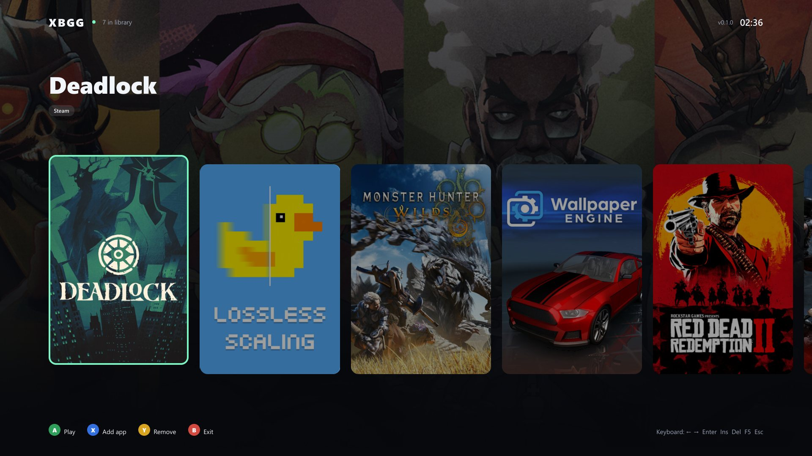

<div align="center">

# XBGG

**A lightweight, full-screen console mode for Windows gaming.**

Browse every installed game from your couch, launch it with a controller, and
let the shell get out of the way — XBGG uses no GPU memory and practically no
CPU while you play.

[](https://github.com/PUTTIPONG-Boss/XBGG/releases/latest)
[](LICENSE)




</div>

## Features

- **One library for every store** — finds installed games from Steam (all
  library folders, with local cover and background art), Epic Games and GOG.
- **Add anything** — any `.exe`, shortcut (`.lnk`, `.url`) or script (`.bat`,
  `.cmd`) that the scanners don't find.
- **Controller first** — Xbox-style controllers, keyboard and mouse all work.
  Input is ignored while a game is in front, so button presses in-game never
  reach the launcher.
- **Built to stay out of the way** — see [Performance](#performance).
- **Safe in-app updates** — new versions are downloaded from GitHub Releases,
  verified with SHA-256 and installed only after you confirm.
- **Recently played first**, hide what you don't want, nothing on disk is ever
  deleted.

## Performance

Measured on an Intel Core i5 12th gen laptop with RTX 3050 Laptop GPU,
1920×1080, 7-game library, release build. Full method and raw results:
[docs/TEST_REPORT.md](docs/TEST_REPORT.md).

| Metric | XBGG v0.1.0 |
|---|---|
| GPU memory (VRAM) | **0 MB** — UI is rendered on the CPU; a laptop's discrete GPU is never woken |
| Private memory | ~26 MB |
| CPU while a game is in the foreground | ~0% (16 ms over 45 s with Deadlock running) |
| CPU while idle in the menu | ~0% |
| Startup to window | ~0.3 s |
| Memory after 500 navigate/dialog/rescan cycles | flat — no leaks |

## Install

1. Download `XBGG-v0.1.0-windows-x64.zip` (or just `xbgg.exe`) from the
   [latest release](https://github.com/PUTTIPONG-Boss/XBGG/releases/latest).
2. Unzip it to a folder you can write to, e.g. `D:\Apps\XBGG` (needed for
   in-app updates — avoid `Program Files`).
3. Run `xbgg.exe`. No installer, no admin rights, no background services.

> **"Windows protected your PC"?** XBGG is not code-signed yet, so SmartScreen
> warns about new downloads. Choose **More info → Run anyway**. You can verify
> the file against `xbgg.exe.sha256` from the release:
> `Get-FileHash xbgg.exe -Algorithm SHA256`. The binary is built from this
> repository and scanned with Microsoft Defender before every release.

## Controls

| Controller | Keyboard | Action |
|---|---|---|
| D-pad / left stick | ← → | Move |
| LB / RB | Page Up / Page Down | Jump 5 |
| A | Enter / Space | Play / Add |
| X | Insert | Add game or app |
| Y | Delete | Remove (custom) / Hide (scanned) |
| View | F5 | Rescan library |
| Menu | U | Install available update |
| B | Esc / Backspace | Back / Exit (asks first) |

Mouse: click a tile to focus it, click again to play.

Other controllers (DualSense, Switch Pro, …) work through Steam Input or
DS4Windows, which present them as XInput devices.

## Command line

```text
xbgg [OPTIONS]

  --windowed       Run in a window instead of full screen
  --no-update      Skip the update check on startup
  --list           Print the detected game library and exit
  --check-update   Check GitHub for a newer release and exit
  --version        Print the version and exit
  --help           Show help
```

## Data & privacy

- Settings live in `%APPDATA%\XBGG\library.json` (custom entries, hidden
  entries, last-played times). To un-hide a game, remove its id from `hidden`
  and press F5.
- The only network request is a check of this repository's latest GitHub
  release at startup (disable with `--no-update`). No telemetry.
- If XBGG ever crashes, the reason is appended to `%APPDATA%\XBGG\crash.log`.

## Building from source

Requires Rust (stable) on Windows; both the MSVC and GNU toolchains work.

```powershell
git clone https://github.com/PUTTIPONG-Boss/XBGG.git
cd XBGG
cargo build --release        # target\release\xbgg.exe
cargo test                   # unit tests
```

Repeatable performance and end-to-end tests live in [`tools/`](tools):
`bench.ps1`, `soak.ps1` (leaks), `focus-soak.ps1`, `custom-entry-test.ps1`
and `game-launch-test.ps1`.

## Project layout

```text
crates/
  xbgg-core/   store scanners (Steam/Epic/GOG), library storage, launching
  xbgg/        Slint UI, artwork pipeline, XInput, updater, Win32 glue
tools/         benchmark, soak and end-to-end test scripts
docs/          test report, screenshots
```

## Roadmap

- **Boost mode** — pause background apps and services, switch power plan and
  game priority while playing, with a crash-safe restore journal.
- **Shell mode** — boot straight into XBGG instead of the desktop.
- **Resource report** — show how much RAM/VRAM/CPU was handed back to the game.
- More stores (Xbox / Game Pass, EA app, Ubisoft Connect, Battle.net).

## License

[MIT](LICENSE) © 2026 PUTTIPONG-Boss
