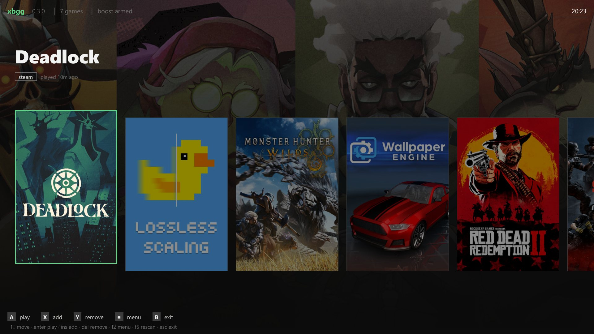
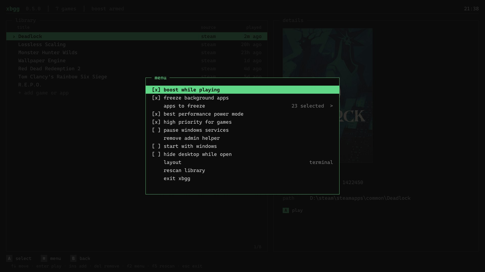

<div align="center">

# XBGG

**A lightweight, full-screen, terminal-style game launcher for Windows.**

Browse every installed game from your couch, launch it with a controller, and
let the shell get out of the way — XBGG uses no GPU memory and practically no
CPU while you play.

[](https://github.com/PUTTIPONG-Boss/XBGG/releases/latest)
[](LICENSE)


</div>

## Features

- **One library for every store** — finds installed games from Steam (all
  library folders, with local cover art), Epic Games and GOG.
- **Two layouts** — *terminal* (a list with a details pane, one monospace
  font, nearly free to draw) or *console* (a cover carousel over the game's
  background art). Switch any time in *Menu → layout*. Both are square-edged:
  no rounded corners, pills or gradients. See [Layouts](#layouts).
- **Add anything** — any `.exe`, shortcut (`.lnk`, `.url`) or script (`.bat`,
  `.cmd`) that the scanners don't find.
- **Controller first** — Xbox-style controllers, keyboard and mouse all work.
  Input is ignored while a game is in front, so button presses in-game never
  reach the launcher.
- **Boost while playing** — frees RAM and CPU for the game by freezing the
  background apps you choose, switches Windows to Best performance, and puts
  everything back when you quit the game. See [Boost](#boost).
- **Built to stay out of the way** — see [Performance](#performance).
- **Safe in-app updates** — new versions are downloaded from GitHub Releases,
  verified with SHA-256 and installed only after you confirm.
- **Recently played first**, hide what you don't want, nothing on disk is ever
  deleted.

## Layouts

| terminal (default) | console |
|---|---|
|  |  |
| List + details, monospace, ~14 MB RAM | Cover carousel + background art, ~26 MB RAM |

Switch in *Menu → layout*; the choice is saved. Menus, dialogs and the key bar
are the same in both.

## Boost

When you launch a game from XBGG, Boost hands the machine over to the game and
gives it back when you're done.

| What | How | Default |
|---|---|---|
| **Freeze background apps** | Suspends the apps you pick and releases their RAM. Nothing is closed: they resume exactly where they were — tabs, documents, everything. | On: browsers, Wallpaper Engine, Teams, Slack, OneDrive, Dropbox, Widgets, Adobe helpers |
| **Best performance power mode** | Switches Windows' power mode slider, restores your previous mode afterwards. | On |
| **High priority for games** | Raises the game's process priority; re-applies it if the game resets it while loading. | Off |
| **Pause Windows services** | Stops and temporarily disables Windows Search indexing, SysMain, Telemetry and Delivery Optimization; restores their exact start types afterwards. Needs a one-time admin setup (below). | Off |

**How to use it:** just launch the game from XBGG. Boost starts when you press
play and ends by itself when the game closes. Games started outside XBGG
(e.g. a desktop shortcut) are not boosted.



- **Choose what gets frozen** in *Menu → Apps to freeze*: every app with a
  window is listed with its live memory use. Discord, Spotify and OBS are
  offered but off by default, since many people use them while playing.
- **Never frozen**, even if listed: Windows components, game launchers (Steam,
  Epic, GOG, Battle.net, EA, Ubisoft, Riot, Xbox) and anti-cheat services.
- **Ends automatically** about 2 seconds after the game exits, or from
  *Menu → End boost now*.
- **Crash-safe**: every change is written to a journal *before* it's made. If
  XBGG is killed, a small guard process restores everything immediately; after
  a power cut, XBGG restores it on the next start. `xbgg --restore` does it by
  hand.
- **Anti-cheat friendly**: Boost never touches the game's memory or code — it
  only suspends *other* apps and, if enabled, sets the game's priority class.

In testing, freezing an app holding 1.5 GB released **1.4 GB of RAM** to the
game within two seconds, and everything resumed **2.4 s** after the game
closed ([details](docs/TEST_REPORT.md#boost)).

### Pausing Windows services (one-time admin setup)

Stopping services needs administrator rights. Turning on *Menu → pause
windows services* shows **one** UAC prompt, after which XBGG:

1. copies itself to `C:\Program Files\XBGG\xbgg-helper.exe` (only
   administrators can change files there), and
2. registers two Task Scheduler tasks, `\XBGG\Pause services` and
   `\XBGG\Resume services`, that run that copy with fixed arguments.

From then on XBGG just starts those tasks — no prompt during play. The helper
takes no input from XBGG: it only touches the four services above and only
restarts what it stopped. When XBGG is updated the menu offers to update the
helper; *Menu → remove admin helper* resumes everything and deletes the tasks
and the copy.

## Shell mode

Use XBGG instead of the Windows desktop:

- **Menu → start with windows** — starts XBGG when you sign in (current user
  only).
- **Menu → hide desktop while open** — closes the desktop and taskbar while
  XBGG is open (Explorer exits, freeing its memory) and brings them back when
  you exit XBGG.

Safety:

- If **File Explorer windows are open**, XBGG leaves the desktop alone and
  asks you to close them first (they live in the same process).
- Coming back, XBGG waits for a working taskbar; if it's missing or stuck, it
  starts a fresh one.
- If XBGG crashes, its guard process brings the desktop back; after a power
  cut, the next start does. `xbgg --restore` does it by hand, and
  <kbd>Ctrl</kbd>+<kbd>Alt</kbd>+<kbd>Del</kbd> → Task Manager → *Run new task*
  → `explorer` always works.
- XBGG does **not** replace the Windows shell in the registry, so a problem
  can never leave you at a black screen when signing in.

## Performance

Measured on an Intel Core i5 12th gen laptop with RTX 3050 Laptop GPU,
1920×1080, 7-game library, release build. Full method and raw results:
[docs/TEST_REPORT.md](docs/TEST_REPORT.md).

| Metric | XBGG v0.5.0 (terminal layout) |
|---|---|
| GPU memory (VRAM) | **0 MB** — UI is rendered on the CPU; a laptop's discrete GPU is never woken |
| Private memory | ~14 MB |
| CPU while a game is in the foreground | ~0% (16 ms over 45 s with Deadlock running) |
| CPU while idle in the menu | ~0% |
| Startup to window | ~0.3 s |
| Memory after 500 navigate/dialog/rescan cycles | flat — no leaks |
| CPU while boosting a running game | ~0% (31 ms over 30 s during the game's first minute, then 0) |

## Install

1. Download `XBGG-v<version>-windows-x64.zip` (or just `xbgg.exe`) from the
   [latest release](https://github.com/PUTTIPONG-Boss/XBGG/releases/latest).
2. Unzip it to a folder you can write to, e.g. `D:\Apps\XBGG` (needed for
   in-app updates — avoid `Program Files`).
3. Run `xbgg.exe`. No installer, no admin rights, no background services.

> **"Windows protected your PC"?** XBGG is not code-signed yet, so SmartScreen
> warns about new downloads. Choose **More info → Run anyway**. You can verify
> the file against `xbgg.exe.sha256` from the release:
> `Get-FileHash xbgg.exe -Algorithm SHA256`. The binary is built from this
> repository and scanned with Microsoft Defender before every release.

## Controls

| Controller | Keyboard | Action |
|---|---|---|
| D-pad / left stick | ↑ ↓ (← → also work) | Move |
| LB / RB | Page Up / Page Down | Jump 5 |
| A | Enter / Space | Play / Add |
| X | Insert | Add game or app |
| Y | Delete | Remove (custom) / Hide (scanned) |
| View | F5 | Rescan library |
| Menu | F2 | Menu: Boost settings, apps to freeze, update, rescan, exit |
| B | Esc / Backspace | Back / Exit (asks first) |

Mouse: click a tile to focus it, click again to play.

Other controllers (DualSense, Switch Pro, …) work through Steam Input or
DS4Windows, which present them as XInput devices.

## Command line

```text
xbgg [OPTIONS]

  --windowed       Run in a window instead of full screen
  --no-update      Skip the update check on startup
  --list           Print the detected game library and exit
  --check-update   Check GitHub for a newer release and exit
  --restore        Undo an interrupted boost / hidden desktop and exit
  --version        Print the version and exit
  --help           Show help
```

## Data & privacy

- Settings live in `%APPDATA%\XBGG\library.json` (custom entries, hidden
  entries, last-played times, Boost settings). To un-hide a game, remove its
  id from `hidden` and press F5.
- While a boost runs, `%APPDATA%\XBGG\boost-journal.json` records what was
  changed; while the desktop is hidden, `%APPDATA%\XBGG\shell-state.json`
  does. Both are deleted when everything is restored.
- Only if you set up service pausing: `C:\Program Files\XBGG\` (helper copy
  and the list of paused services) and the two `\XBGG\…` scheduled tasks.
  *Menu → remove admin helper* removes them.
- The only network request is a check of this repository's latest GitHub
  release at startup (disable with `--no-update`). No telemetry.
- If XBGG ever crashes, the reason is appended to `%APPDATA%\XBGG\crash.log`.

## Building from source

Requires Rust (stable) on Windows; both the MSVC and GNU toolchains work.

```powershell
git clone https://github.com/PUTTIPONG-Boss/XBGG.git
cd XBGG
cargo build --release        # target\release\xbgg.exe
cargo test                   # unit tests
```

Repeatable performance and end-to-end tests live in [`tools/`](tools):
`bench.ps1`, `soak.ps1` (leaks), `focus-soak.ps1`, `custom-entry-test.ps1`,
`game-launch-test.ps1`, `boost-test.ps1` and `update-test.ps1`. `package.ps1`
builds the release assets into `dist\`.

## Project layout

```text
crates/
  xbgg-core/   store scanners (Steam/Epic/GOG), library storage, launching,
               Boost (freeze/restore, power mode, priority, journal)
  xbgg/        Slint UI, artwork pipeline, XInput, updater, boost session, Win32 glue
tools/         benchmark, soak and end-to-end test scripts
docs/          test report, screenshots
```

## Roadmap

- **Resource report** — show how much RAM/VRAM/CPU was handed back to the game.
- More stores (Xbox / Game Pass, EA app, Ubisoft Connect, Battle.net).

## License

[MIT](LICENSE) © 2026 PUTTIPONG-Boss

The embedded [Cascadia Mono](https://github.com/microsoft/cascadia-code) font
is © Microsoft Corporation, licensed under the
[SIL Open Font License 1.1](crates/xbgg/assets/fonts/OFL.txt).
